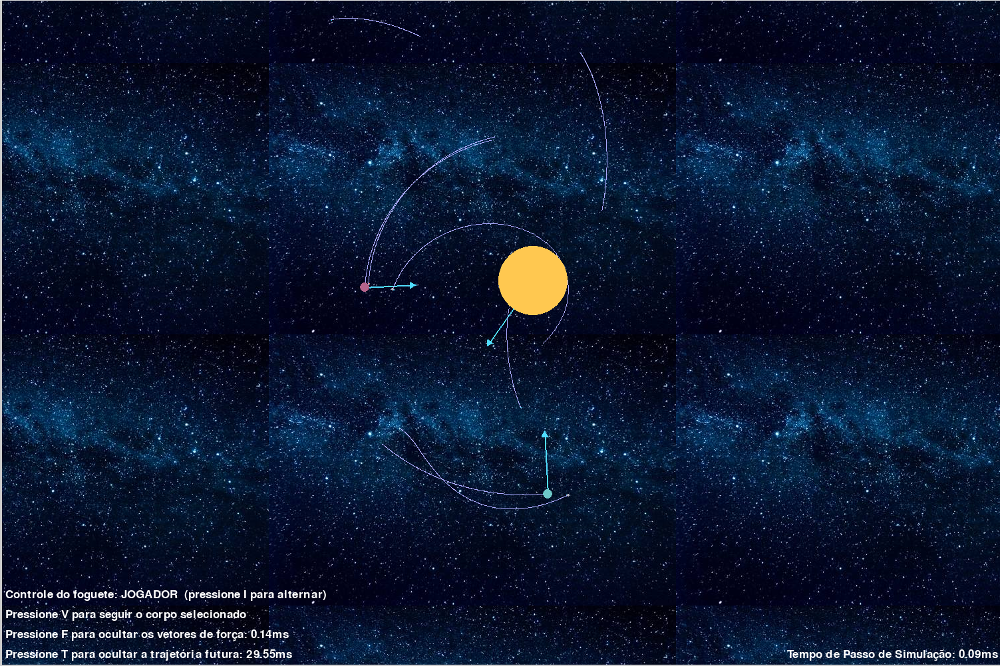
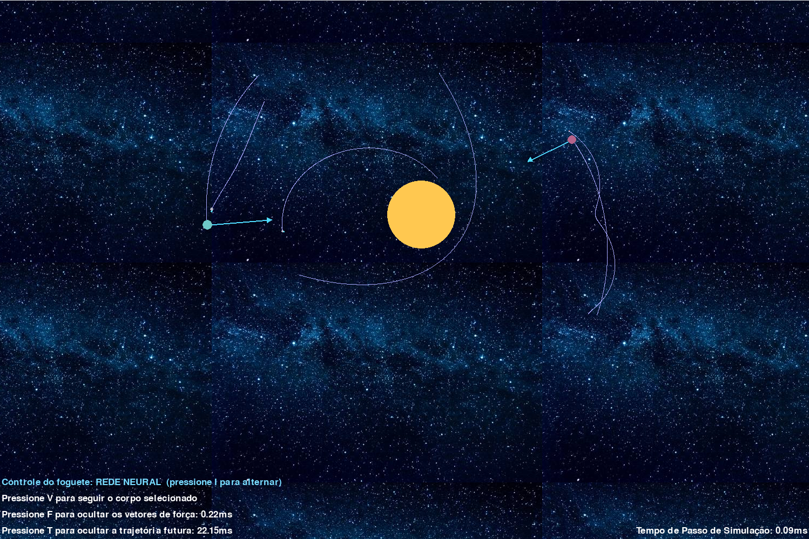
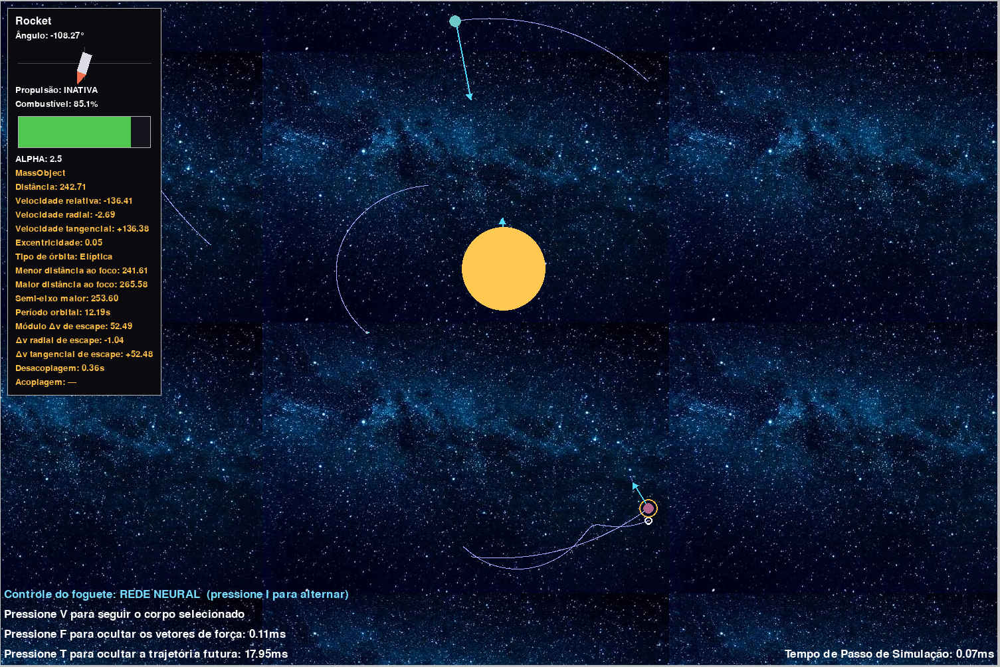

# Gravitation — Simulação gravitacional de N corpos

Simulação 2D de gravitação newtoniana em Pygame, com um foguete
controlável que pode desacoplar de um corpo, voar e pousar em outro.
Inclui visualização de forças, previsão de trajetória, inspector de
elementos orbitais e um módulo de treinamento por redes neurais
(opcional) que ensina o foguete a realizar manobras sozinho.

## O que o simulador faz

- **Física N-corpos** com integração RK4 em passo fixo (120 Hz).
- **Fusão de corpos**: colisões a alta velocidade absorvem o menor
  (massa, momento e volume conservados); contato lento é tratado como
  pouso.
- **Foguete controlável**: rotação e propulsão, tanque de combustível,
  acoplamento/desacoplagem por colisão inelástica.
- **Previsão de trajetória futura** (`T`): simula a evolução do sistema
  por N passos sem alterar o estado real.
- **Vetores de força** (`F`): setas proporcionais à força gravitacional
  resultante sobre cada corpo.
- **Inspector de corpos**: painel com massa, raio, velocidade, elementos
  orbitais relativos (excentricidade, periastro, apoastro, período,
  Δv de escape) e custo de manobras de desacoplagem/acoplagem.
- **Câmera** com zoom ancorado no cursor, pan e modo "seguir".
- **Sistema estelar gerado proceduralmente**: estrelas, planetas, luas
  e meteoros em órbitas estáveis.

## Requisitos

- Python 3.10+
- `pip install pygame numpy torch matplotlib`

(`torch` e `matplotlib` só são necessários para o treinamento e para os
relatórios de memória; a simulação interativa roda apenas com `pygame`.)

## Como executar

**Simulação interativa (modo padrão):**
```bash
python -m src.main
```

Abre a cena com um sistema estelar aleatório e o foguete acoplado a um
planeta. A câmera nasce apontada para o foguete.

**Opções de linha de comando:**
```bash
python -m src.main --model CAMINHO          # carrega uma política treinada
python -m src.main --monitor-memory         # grava snapshots do tracemalloc
```

### Controles

| Tecla / botão | Ação |
|---------------|------|
| ← / → | Rotacionar o foguete |
| Espaço | Propulsão |
| Scroll | Zoom ancorado no cursor |
| Botão esquerdo | Pan (arrasto) / selecionar corpo (clique) |
| Botão direito | Definir corpo de referência do inspector |
| ↑ / ↓ | Ajustar `α` do foguete (raio-alvo em múltiplos de `R_host`) |
| V | Seguir o corpo selecionado |
| F | Exibir vetores de força |
| T | Exibir trajetória futura |
| I | Alternar entre controle do jogador e rede neural |

## Treinamento (opcional)

O foguete pode ser treinado por um algoritmo genético sobre redes
`ActorCritic`. Houve um primeiro treinamento multitarefa capaz de treinar a desacoplar-se 
dos corpos onde está estacionada e atingir uma órbita-alvo com excelente maestria, nos `Resultados`
você pode ver os resultados.

Seguindo com a tentativa de ampliarmos o escopo, tentamos dividir o treinamento
em 4 fases:

| Fase             | Meta                                               |
|------------------|----------------------------------------------------|
| 1 — Desacoplagem | Sair da superfície com segurança                   |
| 2 — Órbita maior | Atingir e manter órbita circular com r > r_inicial |
| 3 — Órbita Menor | Atingir e manter órbita circular com r < r_inicial |
| 4 — Acoplagem    | Estacionar em uma superfície com segurança         |

Cada fase deve reutilizar os resultados da anterior, possuir uma função de recompensa 
específica, apresentar logs inteligentes para posterior debugação. 

```bash
python -m src.train --phase 1     # treina do zero
python -m src.train --phase 2     # fine-tuning da Fase 1
```

Até o presente momento, não conseguimos avançar com essas divisões e nos encontramos
travados na fase 2, pois as redes, mesmo após diversos refinamentos, não apresentaram
comportamentos interessantes dignos de avançarmos.

## Estrutura

```
src/
├── main.py                 # Simulação interativa (entry point)
├── train.py                # Entry point de treinamento
├── config.py               # Parâmetros de janela e física
├── physics/                # RK4, gravidade, colisão, órbitas relativas
├── entities/               # Rocket, MassObject, Entity, Picker
├── engine/                 # Loop, câmera, renderer, HUD, visualizadores
├── control/                # Entrada de teclado e mouse
└── ai/                     # Redes, população e treinadores por fase
```

## Monitoramento de memória (opcional)

```bash
python -m src.main --monitor-memory
python src/assets/mem_report.py mem_dumps/ --save fig.png
```

## Resultados

Segue uma coleção de imagem para descrever como está o sistema.

|                     Sem IA                     |                    Com IA                     |                     Com IA + Rótulos                      |
|:----------------------------------------------:|:---------------------------------------------:|:---------------------------------------------------------:|
|  |  |  |
|                    *Manual*                    |                  *Autônomo*                   |                        *Detalhado*                        |

